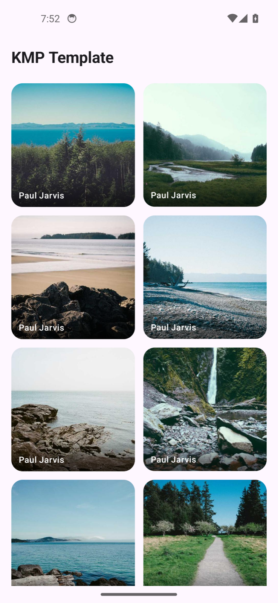
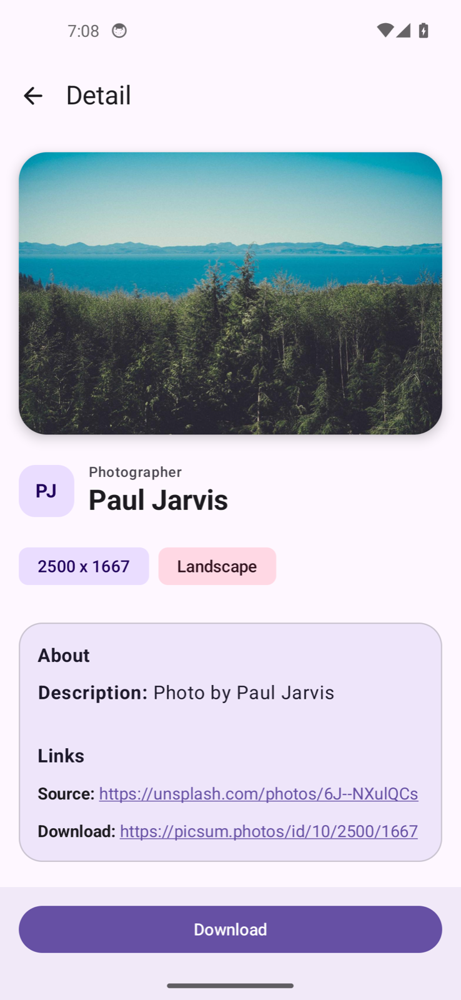
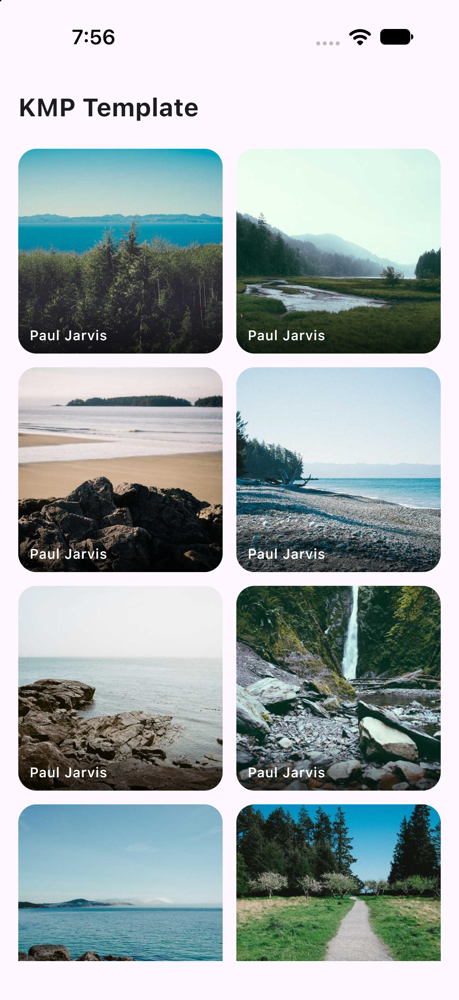
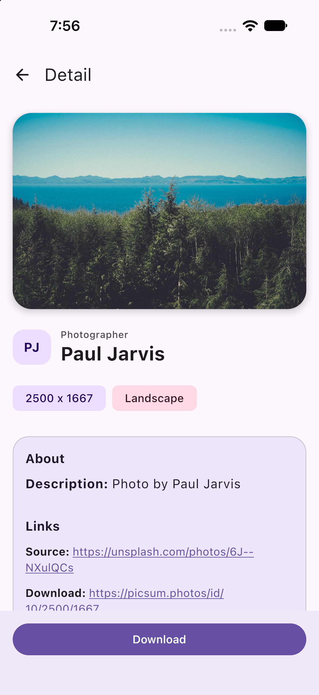

# KMP Template

This template repository provides a quick start for creating new Kotlin Multiplatform apps using
[Compose Multiplatform](https://www.jetbrains.com/compose-multiplatform/) as the UI framework and
targeting Android and iOS from a shared codebase.

It includes the following popular libraries:

- [Ktor](https://ktor.io/) - A multiplatform HTTP client for networking.
- [Metro](https://github.com/ZacSweers/metro) - A multiplatform, compile-time dependency injection
  framework for Kotlin.
- [Navigation3](https://developer.android.com/jetpack/androidx/releases/navigation3) - Multiplatform
  navigation APIs used for the app flow.
- [Room](https://developer.android.com/training/data-storage/room) - Cross-platform local
  persistence for Android and iOS with a shared schema setup.
- [AndroidX DataStore](https://developer.android.com/topic/libraries/architecture/datastore) -
  Key-value persistence for lightweight app preferences.
- [AndroidX Paging](https://developer.android.com/topic/libraries/architecture/paging/v3-overview) -
  Infinite scrolling support for paged image feeds.
- [Coil](https://github.com/coil-kt/coil) - Image loading in Compose Multiplatform.
- [Ktlint](https://pinterest.github.io/ktlint/) - Kotlin code style checks and formatting.

Current toolchain: Kotlin 2.4, AGP 9.5, Gradle 9.8, Compose Multiplatform 1.12.

## How to use

To use this template, simply click on the **Use this template** button at the top (or fork the
repository) and start building your app on top of it.
Before building and deploying your app, update the package name, `applicationId`, the Android
namespaces in `androidApp` and `shared`, the iOS bundle ID in `Config.xcconfig`, and the app name.

## Visuals
<table>
  <tr>
    <th>Home Screen - Android</th>
    <th>Detail Screen - Android</th>
    <th>Home Screen - iOS</th>
    <th>Detail Screen - iOS</th>
  </tr>
  <tr>
    <td></td>
    <td></td>
    <td></td>
    <td></td>
  </tr>
</table>

## Project structure

The project follows the [new default KMP structure](https://blog.jetbrains.com/kotlin/2026/05/new-kmp-default-structure/):
platform entry points are thin apps and all code lives in one shared library module.

- [/shared](./shared/src) is a Kotlin Multiplatform library with all app code:
    - [commonMain](./shared/src/commonMain/kotlin) contains shared logic, UI, and app
      architecture.
    - [androidMain](./shared/src/androidMain/kotlin) contains Android-only implementations. It uses
      the `com.android.kotlin.multiplatform.library` plugin.
    - [iosMain](./shared/src/iosMain/kotlin) contains iOS-only implementations. The module is
      exported to iOS as the `Shared` framework.
- [/androidApp](./androidApp/src/main) is the Android application: `MainActivity`, `Application`
  class, manifest, launcher icons and app-level config.
- [/iosApp](./iosApp/iosApp) is the iOS application: SwiftUI entry point that hosts the shared
  Compose UI.

Dependency injection graphs are created per platform: `createAndroidAppGraph` in `shared/androidMain`
(called from `MyApplication`) and `createGraph<IosAppGraph>()` in `MainViewController`.

## Build and Run Android Application

To build and run the development version of the Android app, use the run configuration from the run
widget in your IDE's toolbar or build it directly from the terminal:

```shell
./gradlew :androidApp:assembleDebug
```

## Build and Run iOS Application

To build and run the development version of the iOS app, use the run configuration from the run
widget in your IDE's toolbar or open the [/iosApp](./iosApp) directory in Xcode and run it from
there. Set `TEAM_ID` in [Config.xcconfig](./iosApp/Configuration/Config.xcconfig) first.

## Unit Testing

- Common Kotlin tests live in `shared/src/commonTest`: PagingSource, repository, API (Ktor
  `MockEngine`), download manager and ViewModel tests. Shared fakes are in `testutil/Fakes.kt`.
- Android host tests: `./gradlew :shared:testAndroidHostTest`
- iOS simulator tests: `./gradlew :shared:iosSimulatorArm64Test`
- Add `androidHostTest` / `androidDeviceTest` / `iosTest` source sets under `shared/src` for
  platform-specific tests.

## Formatting

This project uses [Ktlint](https://github.com/pinterest/ktlint) for Kotlin code style and formatting.

To format Kotlin code, run:

```shell
./gradlew ktlintFormat
```

To check formatting without changing files, run:

```shell
./gradlew ktlintCheck
```

## Release builds

Release builds use R8 (`isMinifyEnabled` and `isShrinkResources`). Keep rules for Room, Ktor and
kotlinx.serialization are in [proguard-rules.pro](./androidApp/proguard-rules.pro). Metro needs
none because its graphs are generated at compile time. Re-check a release build on a device
after adding libraries that use reflection.

## CI/CD

This project includes built-in support for [GitHub Actions](https://github.com/features/actions) to
automate builds, run tests, and ensure code quality.
CI/CD workflows can be found in the `.github/workflows/` directory and can be customized based on
your needs. The Android workflow builds debug and release (R8), runs lint and the host tests.
[Dependabot](./.github/dependabot.yml) opens weekly update PRs, with Kotlin/KSP and Compose
updates grouped so they move together.

## Build and Configuration Caching

This project also takes advantage of
Gradle's [Build Cache](https://docs.gradle.org/current/userguide/build_cache.html)
and [Configuration Cache](https://docs.gradle.org/current/userguide/configuration_cache.html)
features to speed up builds and reduce build times.
Note that these features may not always provide significant improvements in build times depending on
the project structure and build complexity.

## Contribution

Contributions to this project are welcome! If you encounter any problems or have suggestions for
improvement, feel free to submit a pull request or open an issue.

## License

This project is licensed under
the [MIT License](https://github.com/hadiyarajesh/kmp-template/blob/main/LICENSE).
